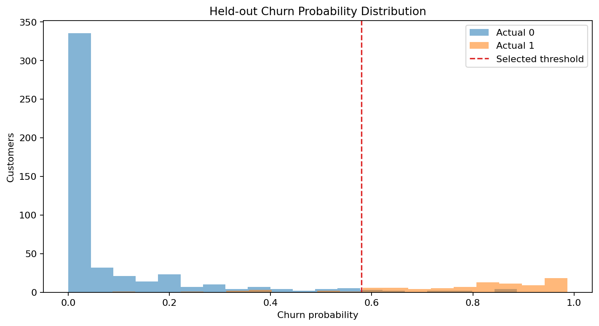
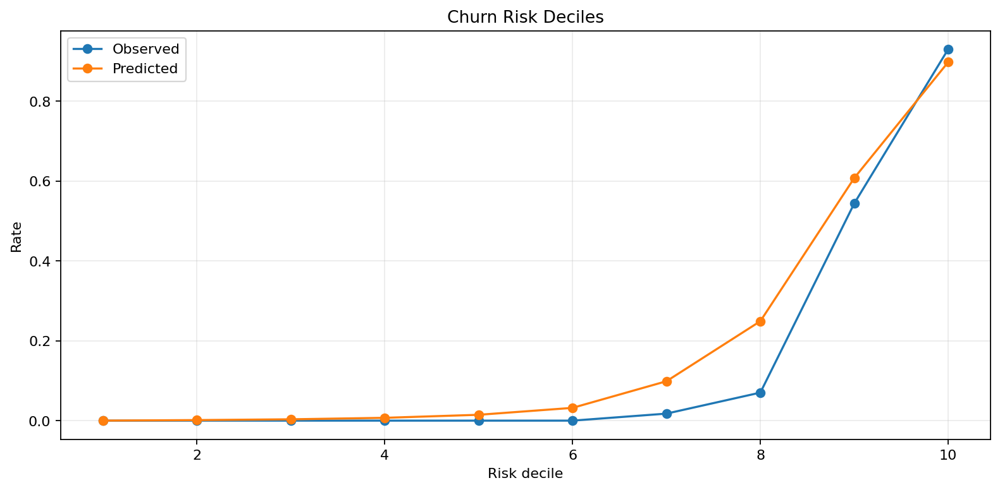
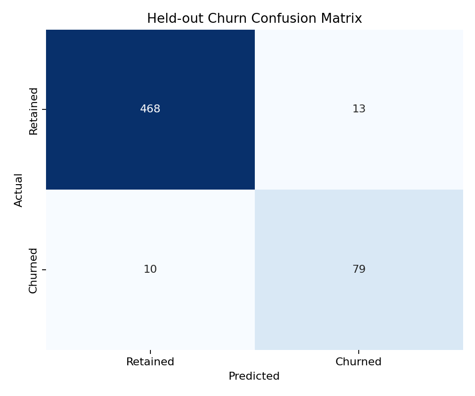
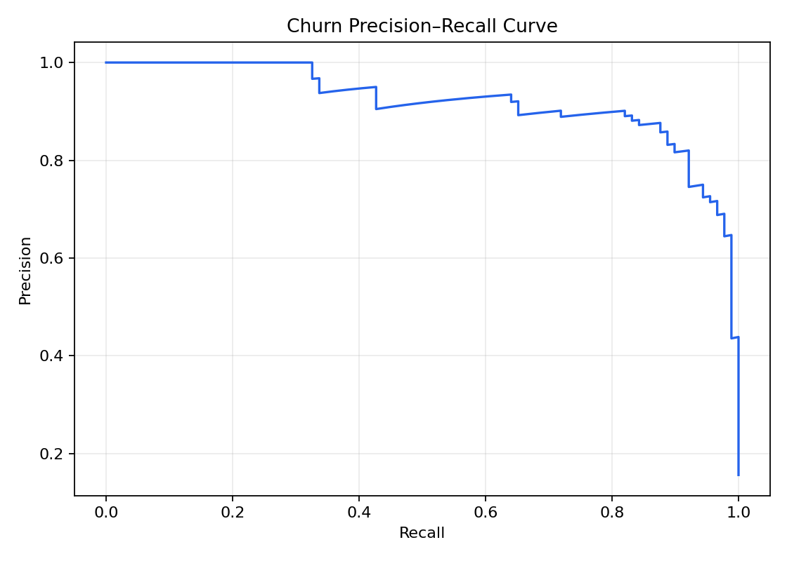

# Telecom Churn Classification

**Author:** Mohammed Adeen Shaik  
**Review date:** 11 October 2026

## Research question

Can a baseline model rank churn risk while meeting a validation recall requirement?

## Data and provenance

UCI Iranian Churn dataset.

Source materials are linked from the repository README. Input fingerprints are recorded in [the evidence manifest](evidence.json) so a reader can identify the exact committed artifacts used in this review.

## Method and analytical rationale

Duplicate rows are removed. Stratified training, validation and test partitions separate learning from model selection. Preprocessing is fitted within pipelines. Validation average precision selects the model and a recall constraint selects its threshold.

## Findings and interpretation

Fresh execution on 11 October 2026 using the committed pipeline and seed 42. Validation selected **random_forest**. On **570** held-out records, precision was **85.9%**, recall **88.8%** and average precision **0.9198**. The test set contained **10** missed positives and **13** false alerts. These are retrospective sample results.

| Measure | Value |
|---|---:|
| average precision | 0.9198 |
| roc auc | 0.9848 |
| precision | 0.8587 |
| recall | 0.8876 |
| f1 | 0.8729 |
| true negatives | 468 |
| false positives | 13 |
| false negatives | 10 |
| true positives | 79 |
| selected model | random_forest |
| decision threshold | 0.5795 |
| validation precision at threshold | 0.8375 |
| validation recall at threshold | 0.7528 |
| validation average precision | 0.8589 |
| churn prevalence | 0.1565 |
| train rows | 1710 |
| validation rows | 570 |
| test rows | 570 |
| random seed | 42 |

## Limitations

A validation recall constraint does not guarantee test or future recall. Random partitions do not demonstrate future-period generalization. Retention effectiveness requires an intervention study.

## Reproduction

Use the setup commands and input contract in the [repository README](https://github.com/Adeen1607/customer-churn-prediction#readme). Open the [notebook catalogue](notebooks.html) for annotated code and saved outputs. Keep raw records and model binaries local; public reports contain aggregate results or source-embedded figures.

## Final visual results

*Figure from key_visuals.ipynb, original code cell 6.*

*Figure from key_visuals.ipynb, original code cell 8.*

*Held-out evaluation figure: confusion_matrix.png.*

*Held-out evaluation figure: precision_recall_curve.png.*

